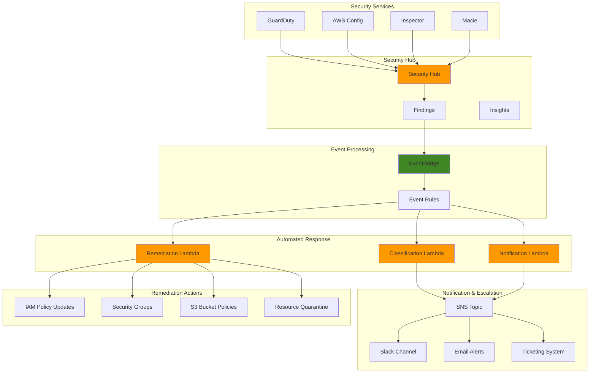

# Security Incident Response Automation

Automated security incident response on AWS — aggregate findings with Security Hub, trigger workflows with EventBridge, and respond with Lambda-powered classification, remediation, and notification.

## Problem

Security teams in enterprises face overwhelming volumes of security alerts and findings from multiple sources, making it challenging to respond effectively to genuine threats. Manual incident response processes are slow, error-prone, and often inconsistent, leading to delayed threat containment and increased security risks. Organizations need automated workflows to classify, prioritize, and respond to security incidents in real-time while maintaining proper audit trails and escalation procedures.

## Solution

An automated security incident response system using AWS Security Hub to aggregate and normalize security findings, EventBridge to trigger automated workflows, and Lambda functions to implement intelligent response actions. The solution includes automated threat classification, incident prioritization, remediation workflows, and notification systems that enable rapid response to security events while reducing manual intervention and ensuring a consistent security posture.

## Architecture

## Key Features

- **Centralized findings** — Security Hub aggregates GuardDuty, Config, Inspector, and Macie findings in the AWS Security Finding Format (ASFF)
- **Intelligent classification** — Lambda logic categorizes findings by severity and content (critical admin issues, malware, MFA/encryption compliance) with escalation decisions
- **Automated remediation** — revokes `0.0.0.0/0` security group rules, applies restrictive S3 bucket policies, and flags IAM issues for manual review
- **Rich notifications** — formatted SNS alerts with severity, affected resources, recommended actions, and deep links to Security Hub
- **Severity-based routing** — EventBridge rules trigger classify + remediate + notify for HIGH/CRITICAL findings, and notification-only for MEDIUM
- **Manual escalation** — Security Hub custom action ("Escalate to Security Team") wired to the notification workflow
- **Incident insights** — Security Hub insights tracking critical incidents and unresolved findings

## AWS Services

| Service | Purpose |
|---|---|
| Security Hub | Findings aggregation, insights, and custom actions |
| EventBridge | Severity-filtered event rules triggering response workflows |
| Lambda | Classification, remediation, and notification functions |
| SNS | Incident notification fan-out (email, Slack, PagerDuty) |
| IAM | Least-privilege incident response role |
| EC2 / S3 | Automated remediation targets (security groups, bucket policies) |
| CloudWatch | Lambda execution logs and audit trails |

## Prerequisites

1. AWS account with Security Hub, EventBridge, Lambda, and SNS permissions
2. AWS CLI v2 installed and configured (or AWS CloudShell)
3. Understanding of security incident response procedures
4. Knowledge of AWS security services (GuardDuty, Config, Inspector)
5. Familiarity with Lambda functions and EventBridge patterns
6. Estimated cost: **$20–50/month** for Security Hub and Lambda execution

> **Note:** This project assumes you have basic security services enabled. Additional costs may apply for GuardDuty, Config, and Inspector if not already active.

## Implementation Overview

1. **Enable Security Hub** — activate with default standards (AWS Foundational Security Standard, CIS AWS Foundations Benchmark)
2. **IAM roles** — incident response role with scoped Security Hub, SNS, EC2, IAM, and S3 permissions
3. **SNS topic** — central notification hub with topic policy granting Lambda publish access
4. **Classification Lambda** — severity/content-based triage that updates findings with categories and recommended actions
5. **Remediation Lambda** — security group restriction, S3 policy hardening, and IAM review flagging with finding status updates
6. **Notification Lambda** — formatted incident alerts with escalation levels, affected resources, and Security Hub deep links
7. **EventBridge rules** — HIGH/CRITICAL rule (classify + remediate + notify) and MEDIUM rule (classify + notify)
8. **Custom actions and insights** — manual escalation action plus insights for critical and unresolved findings
9. **End-to-end testing** — synthetic ASFF findings imported via `batch-import-findings` to validate the full workflow

## Validation & Testing

- Verify Security Hub status and enabled standards
- Invoke each Lambda individually with test payloads
- Confirm EventBridge rules are active with correct targets
- Import synthetic HIGH and CRITICAL test findings and observe classification, remediation, and notification within minutes
- Check Security Hub insight results for critical and unresolved findings

## Cleanup

Remove EventBridge targets and rules, delete the three Lambda functions, delete Security Hub custom actions and insights, delete the SNS topic, remove the IAM role and policy, and clean up local artifacts. Optionally disable Security Hub if no longer needed. Full cleanup commands are documented in the implementation steps.

## License

This project is licensed under the [MIT License](LICENSE).
